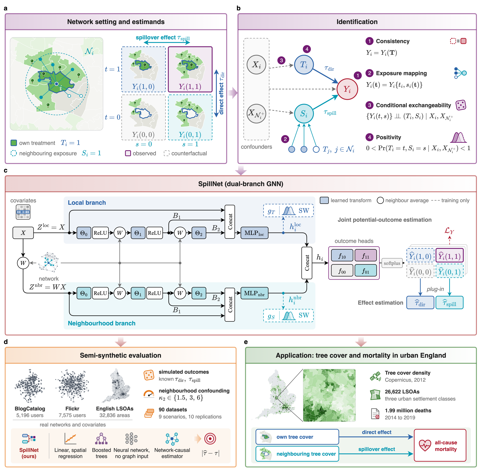

# Estimating direct and spillover effects of urban interventions with a graph neural network

This repository contains SpillNet, the dual-branch graph neural network (GNN) of the study *Estimating direct and spillover effects of urban interventions with a graph neural network*. The overall study design is shown in Figure 1, and the repository holds the model of panel c. The example in [examples/synthetic.py](examples/synthetic.py) runs on synthetic data with known effects and needs no restricted data.



<sub>Overview of the study. (a) Network setting and definitions of direct and spillover effects based on an area's own treatment and neighbouring exposure, shown for a small area in Birmingham and the areas within 1 km. (b) Identification under consistency, exposure mapping, conditional exchangeability and positivity. (c) SpillNet (dual-branch GNN), with separate local and neighbourhood branches, four outcome heads and joint estimation of direct and spillover effects. (d) Semi-synthetic evaluation using two social networks and a geographical network of English small areas, with the comparison methods. (e) Application to tree cover and all-cause mortality in urban England, estimating the effects of an area's own tree cover and that of surrounding areas.</sub>

## Overview

The model estimates the direct effect of a unit's own binary treatment and the spillover effect of treatment among its neighbours. It predicts the potential outcomes under the four combinations of own treatment and neighbourhood exposure, for continuous outcomes or for counts with an offset. This README summarises the model, its use, settings, outputs, run time, requirements and data access.

- [Model](#model)
- [Usage](#usage)
- [Settings](#settings)
- [Outputs](#outputs)
- [Run time](#run-time)
- [System requirements](#system-requirements)
- [Installation](#installation)
- [Data and access](#data-and-access)
- [Repository layout](#repository-layout)
- [Licence](#licence)

## Model

[estimate_effects](spillnet/estimate.py) is the single entry point and runs four steps.

| Step | What it does |
| --- | --- |
| 1 Graph | Row-normalises the adjacency matrix W and forms the neighbour means WX |
| 2 Representation | Encodes X in the local branch and WX in the neighbourhood branch, each with a transform-first graph block ([model.py](spillnet/model.py)) |
| 3 Training | Fits four outcome heads, one for each combination of own treatment and neighbourhood exposure, with propensity heads and sliced-Wasserstein balancing ([training.py](spillnet/training.py), [losses.py](spillnet/losses.py)) |
| 4 Effects | Takes the direct effect μ(1, S<sub>i</sub>) − μ(0, S<sub>i</sub>) and the spillover effect μ(T<sub>i</sub>, 1) − μ(T<sub>i</sub>, 0) of each unit and averages them over units and training seeds |

## Usage

```python
from spillnet import estimate_effects

res = estimate_effects(X, W, T, S, Y)
res = estimate_effects(X, W, T, S, deaths, family="poisson", offset=expected)
print(res["direct"], res["spillover"])
```

| Argument | What it is |
| --- | --- |
| `X` | Covariates, an n × p array |
| `W` | Adjacency or spatial weights, an n × n sparse matrix |
| `T` | Own treatment, 0 or 1 |
| `S` | Neighbourhood exposure, 0 or 1. The study sets S = 1 when the share of treated neighbours exceeds its median |
| `Y` | Outcome, continuous or counts |
| `family` | `"gaussian"` (default) or `"poisson"` |
| `offset` | Expected counts or person-time for `"poisson"`, scaled so that rates are of order 1 |
| `mask` | Units with outcome data. The other units stay in the network |
| `seed`, `n_seeds` | Split seed and number of training seeds, 777 and 3 by default |
| `device` | `"cpu"` (default) or `"cuda"` |

## Settings

The settings are those of the study and are fixed in [training.py](spillnet/training.py) and [estimate.py](spillnet/estimate.py).

| Setting | Value |
| --- | --- |
| Split | 70% training, 15% validation, 15% not used |
| Optimiser | Adam, learning rate 0.005, weight decay 10<sup>−5</sup>, gradient norm clipped at 5 |
| Early stopping | Validation outcome loss, patience 50 epochs, at most 2,000 epochs |
| Loss weights | Balancing 0.01 with 50 projections, propensity 1 |
| Training | Full batch and transductive |

## Outputs

`estimate_effects` returns a dictionary, averaged over the training seeds.

| Key | What it is |
| --- | --- |
| `direct`, `spillover` | Average effects over the units in `mask` |
| `direct_i`, `spillover_i` | Effects for each unit |
| `potentials` | n × 4 potential outcomes, columns (T, S) = 00, 01, 10, 11 |
| `rr_direct`, `rr_spillover` | Relative risks, for `"poisson"` only |

## Run time

[examples/synthetic.py](examples/synthetic.py) fits a continuous and a count outcome on 4,000 units, with three training seeds each. It took 28 seconds on an Apple M2 CPU and printed the following.

```
continuous outcome: direct 0.980 (true 1.000), spillover 0.510 (true 0.500)
count outcome: direct -0.118 (true -0.122), spillover -0.082 (true -0.081), relative risks 0.879 and 0.914
```

In the study, one fit on a social network took about 4 seconds on an NVIDIA RTX 4090 GPU.

## System requirements

The code is written in Python, with no compiled components. It was tested with Python 3.10.17, PyTorch 2.7.1, NumPy 2.2.5 and SciPy 1.15.2. Dependencies are listed in [pyproject.toml](pyproject.toml). On a CPU, fits are repeatable on the same machine, but they may not be bit-identical across platforms or devices.

## Installation

```
git clone https://github.com/ShujuanChen/SpillNet.git
cd SpillNet
python -m pip install .
```

## Data and access

No study data are distributed in this repository. The example generates its own synthetic data.

## Repository layout

```
SpillNet/
├── README.md                    # this file
├── LICENSE                      # MIT licence
├── pyproject.toml               # package metadata and dependencies
├── Schematic_study_design.png   # Figure 1 study-design schematic
├── spillnet/
│   ├── __init__.py              # estimate_effects and SpillNet
│   ├── estimate.py              # graph preparation, split, seeds and effects
│   ├── model.py                 # graph block, branches, outcome and propensity heads
│   ├── training.py              # one fit with the study's settings
│   └── losses.py                # balancing and Poisson deviance
└── examples/
    └── synthetic.py             # synthetic network with known effects
```

## Licence

This repository is released under the MIT licence. The full text is in [LICENSE](LICENSE).
